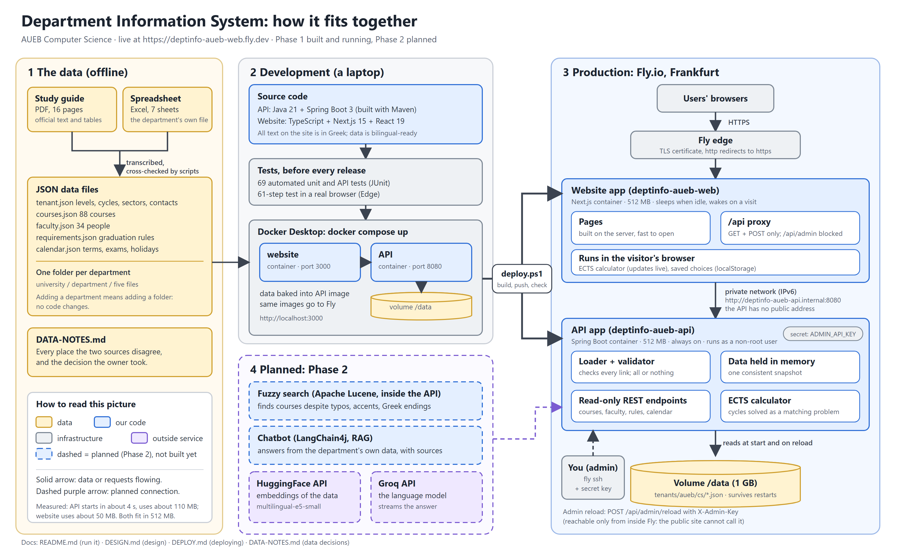

# Department Information System: how it works and why

A website where AUEB Computer Science students and staff browse **courses, faculty, graduation rules and the academic calendar**,
and use an **ECTS calculator** that shows what a student still needs to graduate.

**Live:** https://deptinfo-aueb-web.fly.dev  ·  **Phase 1** (browsing + calculator) is live  ·  **Phase 2** (typo-tolerant search + chatbot) is planned.

*Editable version of the picture: `docs/architecture.svg`.*

## How a visit works

1. The browser opens the site over HTTPS.
2. The **website** (Next.js) builds the page.
3. It asks the **API** (Spring Boot) for the data, over a private network. The API has no public address.
4. The API answers instantly from memory: it loaded the department's JSON files from its disk when it started.
5. The ECTS calculator asks the API again every time the student changes a tick, so the total is always current.
6. To change the data, an admin uploads new files and triggers a reload. No redeploy is needed.

## How we built it

| Step | What we did | Why |
|------|-------------|-----|
| 1 | Agreed the scope: two phases, browsing first | Useful early; Phase 1 needs no AI service and has no cost risk |
| 2 | Got the data right: PDF and spreadsheet cross-checked with scripts; every conflict decided by the owner and written down | The site is only as trustworthy as its data |
| 3 | Stored data as plain JSON files, one folder per department | Tiny data, edited from a spreadsheet; a new department is a new folder |
| 4 | Built the API: checks all data at startup, serves it read-only, runs the calculator | A typo in the data must fail loudly, never silently reach a student |
| 5 | Built the website: pages follow University → Department → Section → Item, all in Greek | Familiar, predictable navigation |
| 6 | Tested in layers: 69 automated tests, plus a 61-step test in a real browser | The browser test found bugs the others could not |
| 7 | Packaged both parts in **Docker** | See below |
| 8 | Deployed to **Fly.io** | See below |
| 9 | Operations: data updates without redeploying; one command (`deploy.ps1`) to redeploy | Easy for anyone on the team |

## Why Docker

- **Same everywhere.** A Docker *image* holds the app plus the exact Java or Node it needs. What we test on a laptop is what runs in production. (Our laptop had the wrong Java version installed; Docker made that irrelevant.)
- **One command to run it all.** `docker compose up` starts the website, the API and the data disk the way production does.
- **Small and safer.** Build tools are left out of the final images, the apps run as non-root users, only the website is exposed, and each part has a health check.
- **Data kept apart from code.** The data lives on a separate disk (a *volume*). The first start copies the starting data in; updating the code never touches live data.

Measured: the API uses about 110 MB of memory and starts in about 4 seconds; the website uses about 50 MB.

## Why Fly.io

- It runs our Docker images unchanged: the image tested locally is the image deployed.
- A private network joins the two apps, so the API is not on the internet.
- HTTPS is included, the website sleeps when idle, and the Frankfurt region is close to Greece.
- It is **not free**: expect a small monthly bill. The exact amount is not verified; check the Fly dashboard.

## Key decisions

| Decision | Why | Trade-off |
|----------|-----|-----------|
| JSON files held in memory, no database | The data is tiny (under 1 MB) and comes from a spreadsheet | A reload is needed after edits; no simultaneous editing |
| A reload swaps the whole dataset at once | A visitor never sees half-updated data; invalid data is rejected | None that matters at this size |
| The website forwards API calls | The API stays private and admin actions are blocked from the internet | One extra hop |
| The calculator is an estimate | It cannot check grades or exemptions, so it lists what it does not check | Students confirm with the secretary |
| Students type ECTS for other departments' courses | Neither source gives them, and we do not invent numbers | A little typing |
| The owner's decisions override the sources | The two sources contradict each other on study cycles | Recorded in `DATA-NOTES.md` |

## What went wrong, and what we learned

- **The sources disagreed** (study cycles, prerequisites, semesters). Lesson: write down every decision.
- **We once deployed only half the system**: the new website with the old API, so typed ECTS were ignored. Lesson: the deploy script now ships both parts and tests a real feature.
- **Small environment surprises** (Docker's tools not on PATH, a health check using the wrong address). Lesson: run the real thing and look at it; reading the code would not have found them.

## Limits and next steps

- **Data gaps:** the instructor is missing for 48 of 68 courses, descriptions for 36, and there are no eClass links or staff emails. The site shows these gracefully.
- **Scope:** one department so far, and one API machine, which is enough at this size.
- **Next:** fill the data gaps (an Excel template), import data straight from the spreadsheet, then Phase 2.

## Where things are

`README.md` run it locally · `DEPLOY.md` deploy and update · `data-seed/…/DATA-NOTES.md` every data decision ·
`docs/design-detailed-archive.md` the original detailed design (partly superseded).
