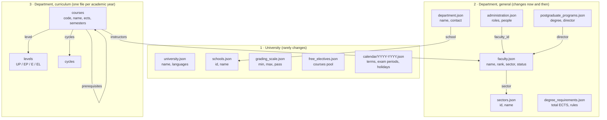

# Schema map

How the JSON files of one university fit together. Arrows are references by id: if the id they point to does not exist, the checker reports it.



## What each file holds

### 1. University

| File | What it holds |
|---|---|
| `university.json` | The university's name in each language, short name, website, country, the languages the site uses and which one shows first. |
| `schools.json` | The schools or faculties of the university. Each has an id and a name. Departments belong to one of them. |
| `grading_scale.json` | Lowest and highest grade, the pass mark, and optionally named bands such as "Excellent". |
| `free_electives.json` | Courses that any student of the university may take as free electives, with code, name, ECTS and the department that teaches them. |
| `calendar/YYYY-YYYY.json` | One academic year: the teaching terms, the exam periods and the holidays, each with dates. |

### 2. Department, general

| File | What it holds |
|---|---|
| `department.json` | The department's name, which school it belongs to, website, email, phone, address and a short introduction. |
| `sectors.json` | The sectors (divisions) of the department, each with an id, a name and an optional description. |
| `faculty.json` | The teaching and research staff: name, rank, sector, status (active, on leave, retired, emeritus, former), the years they taught here, and contact details. |
| `administration.json` | Who holds which role, such as head of department or secretariat, with name and contact details. |
| `postgraduate_programs.json` | The postgraduate programmes: name, degree type, length, ECTS, director and website. |
| `degree_requirements.json` | What a student needs to graduate: total ECTS, minimum semesters, and each rule as a title and a sentence. |

### 3. Department, curriculum (one file per academic year)

| Part | What it holds |
|---|---|
| `levels` | The kinds of course, for example mandatory (UP), core elective (EP), elective (E) and free elective (EL). Each level has an id, a short label and a name. |
| `cycles` | The study cycles or tracks that courses can belong to. Optional. |
| `courses` | Every course of that year: code, name, ECTS, the semesters it runs in, and its links to a level, cycles, prerequisites and teachers. |
| `ects_caps` | Limits on how many ECTS a student may take per semester or per year. Optional. |

## What each connection means

An arrow reads "the thing at the start names an id found in the file at the end".

| Connection | In plain words | What the checker does |
|---|---|---|
| `department` → `schools` (school) | The department says which school it belongs to. | Reports it if that school id is not in `schools.json`. |
| `faculty` → `sectors` (sector) | Each staff member says which sector they work in. | Reports it if the sector id is not in `sectors.json`. |
| `administration` → `faculty` (faculty_id) | A role can point at the person in the faculty list who holds it, so details are written once. | Reports it if that person is not in `faculty.json`. |
| `programs` → `faculty` (director) | A programme names its director from the faculty list. | Reports it if that person is not in `faculty.json`. |
| `courses` → `levels` (level) | Every course says what kind of course it is. | Reports it if the level is not in the `levels` list of the same file, and lists the levels that exist. |
| `courses` → `cycles` (cycles) | A course lists the cycles it belongs to. | Reports it if a cycle is not in the `cycles` list of the same file. |
| `courses` → `faculty` (instructors) | A course lists who teaches it. | Reports it if a person is not in `faculty.json`. Teachers who are not in the faculty list can be written by name in `instructor_names` instead. |
| `courses` → `courses` (prerequisites) | A course lists the courses a student should pass first, using their codes. | Reports it if a code does not exist in the same file, or if a course lists itself. |

Two more checks have no arrow because they stay inside one file: ids and course codes must be unique, and an exam period that names a term must name one that is in that calendar. Also, the year inside a calendar or curriculum file must match its file name.

## Where the files live

```
content/<university>/
  university/
    university.json, schools.json, grading_scale.json, free_electives.json
    calendar/YYYY-YYYY.json          one file per year
  <department>/
    general/
      department.json, faculty.json, sectors.json, administration.json,
      postgraduate_programs.json, degree_requirements.json
      YYYY-YYYY/                     older versions of the files above (not faculty)
    curriculum/
      YYYY-YYYY.json                 one file per year
```

## Previous years

Each year keeps its own calendar and curriculum, so old years are never overwritten. Staff who left stay in the faculty list with the status `former`. Older versions of department files go in a year folder under `general/`.

## Not covered yet

Faculty and courses cannot be shared between departments, a department has one curriculum per year, and degree requirements are plain sentences. See the [roadmap](roadmap.md), step 2.
