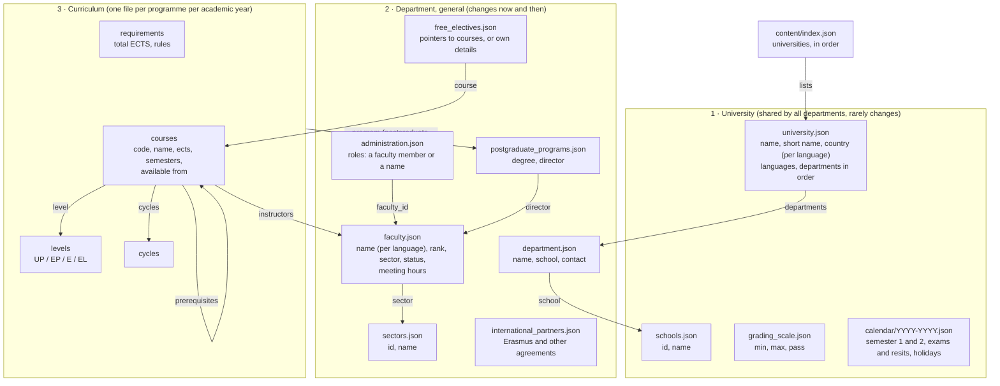

# Schema map

How the JSON files fit together. Arrows are references by id: if the id they point to does not exist, the checker reports it.

The structure is **University → School → Department → Programme**. A programme is either undergraduate or postgraduate.



References can also point into **another department** of the same university: a teacher, a prerequisite, a programme director, an administration role, or a free elective. See "Reference to another department" below.

## What each file holds

### Top of `content/`

| File | What it holds |
|---|---|
| `index.json` | The universities the site shows, in order. A university that is not listed is not shown. |

### 1. University

| File | What it holds |
|---|---|
| `university.json` | The university's name, short name and country, each written per language (for example short name `AUEB` in English and `ΟΠΑ` in Greek). Also the website, the languages the site uses (optional, only English `en` and Greek `el`), which one shows first, and the departments to show, in order. |
| `schools.json` | The schools of the university. Each has an id and a name. A department may belong to one. |
| `grading_scale.json` | Lowest and highest grade, the pass mark, and optionally named bands such as "Excellent". Numbers only. |
| `calendar/YYYY-YYYY.json` | One academic year, the same for every department. It has two semesters, semester 1 (winter, October to January) and semester 2 (spring, February to June), plus the exam periods and the holidays, each with dates. Exam periods are either `regular` or `resit`, the September revision exams for students who have not passed. |

### 2. Department, general

| File | What it holds |
|---|---|
| `department.json` | The department's name, which school it belongs to (optional), website, email, phone, address and a short introduction. |
| `sectors.json` | The sectors (divisions) of the department, each with an id, a name and an optional description. |
| `faculty.json` | The staff. Each person has an id, a name per language, rank (with an optional own title when the rank is `other`), sector, status (active, on leave, retired, emeritus, former), the years they taught here, meeting hours per language, and contact details. A person is written once, here, and every other file points at them by id. |
| `administration.json` | Who holds which role, such as head of department. A role points at a faculty member with `faculty_id`, or, for staff who are not faculty such as the secretariat, carries its own name per language. Never both. |
| `free_electives.json` | The department's free electives. Each entry points at a course (`course`), or, for a course not in any curriculum on the site, carries its own code, name and ECTS. Never both. |
| `international_partners.json` | Partner universities abroad: name per language, country, the kind of agreement (`erasmus`, `exchange`, `double_degree` or `other`), Erasmus code, study levels, website and notes. |
| `postgraduate_programs.json` | The postgraduate programmes: name, degree type, length, director and website. Their requirements and courses are in the curriculum files. |

Older versions of these files can go in a year folder, `general/YYYY-YYYY/`. `faculty.json` has no older versions. People who left stay in it with the status `former`.

### 3. Department, curriculum (one file per programme per academic year)

| Part | What it holds |
|---|---|
| `degree` | Says what the curriculum is: `undergraduate` (bachelor's) or `postgraduate` (master's and other postgraduate programmes). |
| `program` | Postgraduate only: the id of the programme, taken from `postgraduate_programs.json`, where its name and director are written once. Left out for undergraduate. |
| `requirements` | What a student needs to graduate from this programme and year: total ECTS, minimum semesters and the rules, each a title and a sentence. |
| `ects_caps` | Limits on how many ECTS a student may take per semester or per year. Optional. |
| `levels` | The kinds of course, for example mandatory (UP), core elective (EP), elective (E) and free elective (EL). Each level has an id, a short label and a name. |
| `cycles` | The study cycles or tracks that courses can belong to. Optional. |
| `courses` | Every course of that year: code, name, ECTS, the semesters it is taught in, optionally the earliest semester a student may take it (`available_from`), teaching language, and its links to a level, cycles, prerequisites and teachers. |

Levels and cycles are written again in every curriculum file on purpose, so an old year always shows what applied then. To start a new year, copy last year's file.

## What each connection means

An arrow reads "the thing at the start names an id found in the file at the end".

| Connection | In plain words | What the checker does |
|---|---|---|
| `index` → `university` | The index lists the university folders to show. | Reports a listed university that has no folder. Notes a folder that is not listed. |
| `university` → `department` (departments) | The university lists its departments in order. | Reports a listed department that has no folder. Notes a folder that is not listed. |
| `department` → `schools` (school) | The department says which school it belongs to. | Reports it if that school id is not in `schools.json`. |
| `faculty` → `sectors` (sector) | Each staff member says which sector they work in. | Reports it if the sector id is not in `sectors.json`. |
| `administration` → `faculty` (faculty_id) | A role points at the person who holds it, so their name is written once. | Reports it if that person is not in the faculty list. |
| `programs` → `faculty` (director) | A programme names its director. | Reports it if that person is not in the faculty list. |
| `free electives` → `courses` (course) | A free elective points at the real course, so its name and ECTS come from there. | Reports it if that course does not exist. |
| `curriculum` → `programs` (program) | A postgraduate curriculum says which programme it belongs to. | Reports it if the programme is not in `postgraduate_programs.json`, or if the file is not in the folder named after it. |
| `courses` → `levels` (level) | Every course says what kind of course it is. | Reports it if the level is not in the `levels` list of the same file, and lists the levels that exist. |
| `courses` → `cycles` (cycles) | A course lists the cycles it belongs to. | Reports it if a cycle is not in the `cycles` list of the same file. |
| `courses` → `faculty` (instructors) | A course lists who teaches it. | Reports it if a person is not in the faculty list. Teachers in no faculty list can be written by name in `instructor_names`. |
| `courses` → `courses` (prerequisites) | A course lists the courses a student should pass first. | Reports it if the course does not exist, or if a course lists itself. |

Other checks that stay inside one file or compare two values:
- ids and course codes are unique;
- an exam period that names a term names one that is in that calendar;
- the year inside a calendar or curriculum file matches its file name;
- semester 1 must run October to January, semester 2 February to June, one of each;
- `last_year` is not before `first_year`, and `other_title` is used only with the rank `other`;
- `available_from` is not later than the first semester the course is taught in;
- `default_language` is one of the university's `languages`.

A curriculum year with no calendar only produces a note. It never stops a change.

## Reference to another department

A teacher, prerequisite, director, administration role or free elective can point into another department of the same university. The department folder name goes first:

| You write | It means |
|---|---|
| `smith-john` | the person in this department's `faculty.json` |
| `mathematics:euler-leo` | the person `euler-leo` in the department `mathematics` |
| `3117` | the course in this same curriculum file |
| `mathematics:1001` | course `1001` of the department `mathematics`, in the same academic year |
| `computer-science/msc-data-science:DS501` | course `DS501` of one postgraduate programme of that department |
| `computer-science/undergraduate:2010` | course `2010` of that department's undergraduate programme |

A person or course is still written once, in its own department. If a code exists in several programmes of one department, the checker asks you to say which.

## Where the files live

```
content/
  index.json
  <university>/
    university/
      university.json, schools.json, grading_scale.json
      calendar/YYYY-YYYY.json          one file per year
    <department>/
      general/
        department.json, faculty.json, sectors.json, administration.json,
        free_electives.json, international_partners.json,
        postgraduate_programs.json
        YYYY-YYYY/                     older versions of the files above (not faculty)
      curriculum/
        YYYY-YYYY.json                 undergraduate, one file per year
        <programme-id>/                one folder per postgraduate programme
          YYYY-YYYY.json
```

## Previous years

Each year keeps its own calendar and curriculum, so old years are never overwritten. Staff who left stay in the faculty list with the status `former`. Older versions of department files go in a year folder under `general/`.

## Not covered yet

- Contact details and a logo for the university.
- The Greek and English names of the fixed lists (ranks, statuses, degree types), which the website needs. They belong to the site design (roadmap step 6).
- A university with three semesters (some postgraduate programmes) is not supported.
